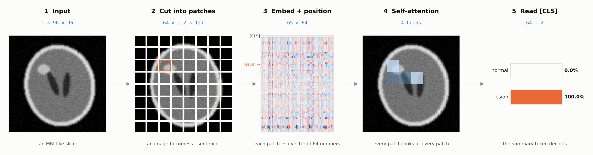
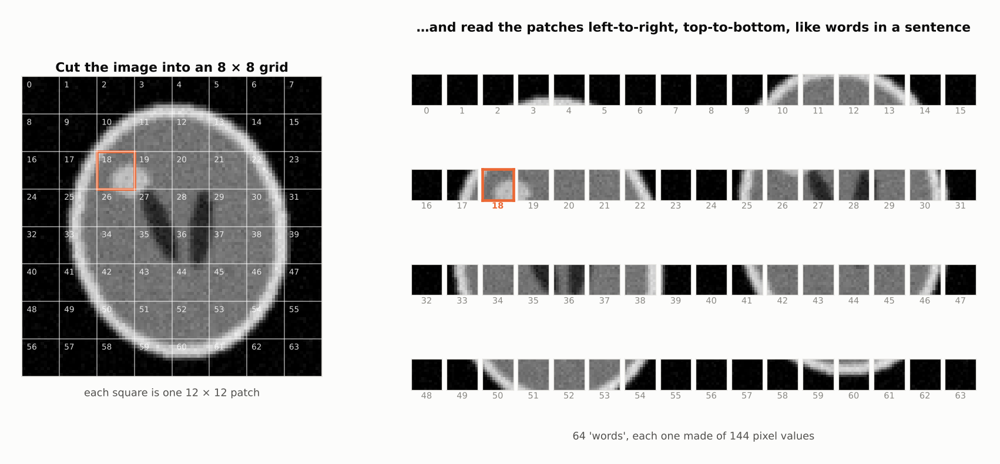
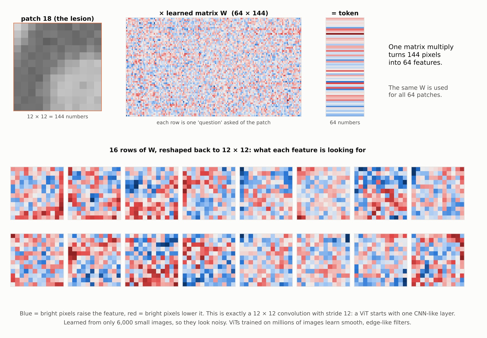
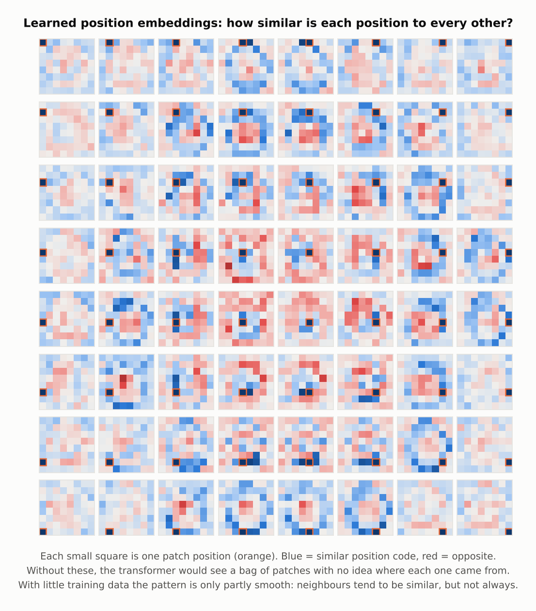
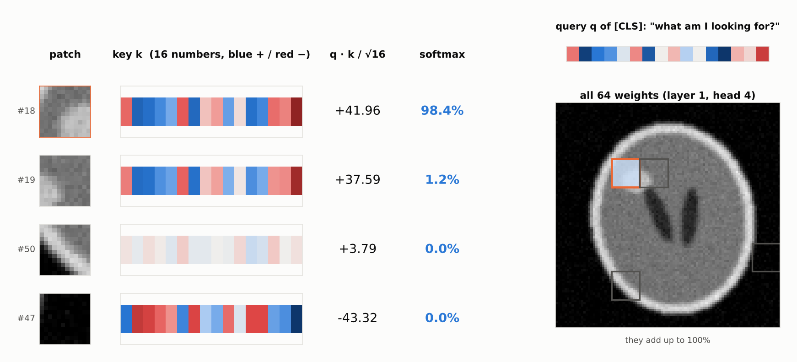
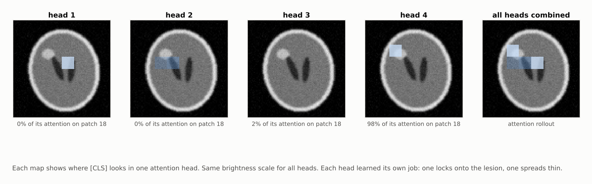
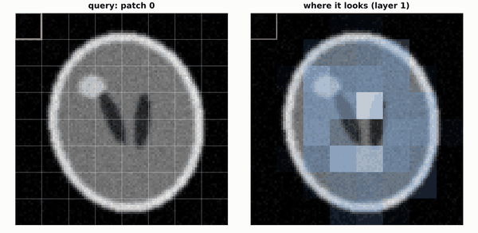
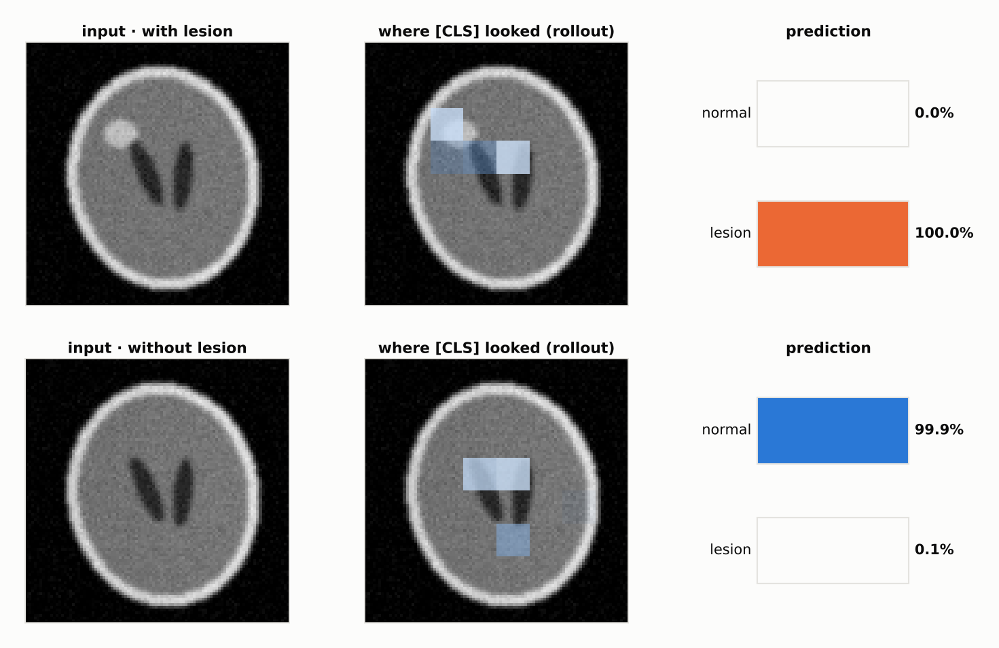
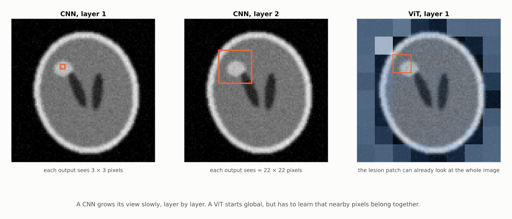

<h1 align="center">How a Vision Transformer (ViT) works</h1>

<p align="center">
  <b>Follow one brain-MRI-style image through a Vision Transformer, step by step:<br>
  patches, embeddings, self-attention and the [CLS] token, all re-done by hand in NumPy.</b>
</p>

<p align="center">
  
  
  
  
</p>

<p align="center">
  
</p>

Transformers took over language, then vision, and now medical imaging. Most explanations stop at the
architecture diagram. This repo takes **one real input** and shows the actual numbers at every step, including
the moment one attention head puts **98% of its attention on the lesion**.

> [!TIP]
> Companion repo: **[How a CNN works, one image at a time](https://github.com/anupbagale/cnn-one-image)**
> follows the *same* slice through a convolutional network, so you can compare the two side by side.

| Step | What happens | Shape |
|:---:|---|:---:|
| 1 | Cut the image into 12 × 12 patches | `64 × 144` |
| 2 | Turn each patch into a vector (patch embedding) | `64 × 64` |
| 3 | Add a `[CLS]` token and position embeddings | `65 × 64` |
| 4 | Self-attention: every token looks at every token | `4 heads × 65 × 65` |
| 5 | MLP + residual connections | `65 × 64` |
| 6 | Read only the `[CLS]` token → softmax | `2` |

---

## 1 · An image becomes a sentence



Transformers were built for text, where the input is a sequence of words. A ViT makes an image look like a
sequence: cut it into an 8 × 8 grid of patches and read them left-to-right, top-to-bottom. Our lesion lands mostly
in **patch 18** (orange).

```python
# vit/numpy_vit.py
def patchify(img, p=12):           # (96, 96) -> (64, 144)
    g = img.shape[0] // p
    return img.reshape(g, p, g, p).transpose(0, 2, 1, 3).reshape(g * g, p * p)
```

## 2 · Patch embedding: 144 pixels → 64 numbers



One learned matrix turns every patch into a 64-number **token**. Reshape its rows back to 12 × 12 and you get
filters, which is the surprising part: **a ViT's first layer is just a convolution** with a 12 × 12 kernel and
stride 12.

## 3 · Position embeddings: "where did this patch come from?"

<p align="center">
  
</p>

Attention has no built-in sense of order. Shuffle the patches and it would give the same answer. So the model
**learns** a vector for each position and adds it to the token. Each small map shows how similar one position's
vector is to all others.

We also put one extra learned token at the front: **`[CLS]`**. It starts with no image content. Its job is
to collect information from the patches and, at the end, be the only token the classifier reads.

## 4 · Self-attention, worked by hand



Every token produces three vectors:

- **query `q`**: what am I looking for?
- **key `k`**: what do I contain?
- **value `v`**: what will I pass on if someone looks at me?

Attention compares the `[CLS]` query with every patch's key, `score = q · k / √16`, then a softmax turns the
64 scores into weights that add up to 100%. Here, the lesion patch scores **+42**, a dark background patch
scores **−43**, and after the softmax the lesion patch gets **98.4%** of this head's attention. `[CLS]` then
takes a weighted average of the values, so it now mostly carries the lesion patch's information.

```python
scores = q @ k.T / np.sqrt(d)        # how well each key matches each query
attn   = softmax(scores, axis=-1)    # each row sums to 1
out    = attn @ v                    # weighted average of values
```

## 5 · Four heads, four jobs



Attention runs 4 times in parallel, each **head** with its own q, k and v. Nobody tells them what to do.
In this model, head 4 learned to find the lesion, heads 1 and 2 learned to watch fixed spots around the
ventricles, and head 3 spreads thin across the image.

## 6 · Every patch can look anywhere, from layer one

<p align="center">
  
</p>

The animation steps through all 64 patches as the query (it pauses on the lesion patch). Each one can attend to
any other patch in the image, from the very first layer.

## 7 · The decision, and a sanity check



Same anatomy, lesion removed: the attention on patch 18 disappears and the prediction flips from
**100.0% lesion** to **99.9% normal**.

## 8 · CNN vs ViT: how far can each layer see?



| | CNN ([companion repo](https://github.com/anupbagale/cnn-one-image)) | ViT (this repo) |
|---|---|---|
| Basic unit | pixel neighbourhood | 12 × 12 patch |
| What layer 1 can see | 3 × 3 pixels | the whole image |
| Built-in assumption | nearby pixels belong together | none, it must be learned |
| Sense of position | built into the sliding window | learned position embeddings |
| Needs lots of data? | less | more (we needed 6,000 images and a learning-rate schedule) |
| Explanation tool | activation × weight maps, Grad-CAM | attention maps, attention rollout |

---

## Results

| | |
|---|---|
| Model | 1 transformer block, 4 heads, 64-dim tokens, **47,234 parameters** |
| Training | 6,000 synthetic slices, 30 epochs, Adam with cosine learning-rate decay |
| **Held-out test accuracy** | **99.5%** on 400 new slices (the same test set as the CNN repo) |
| NumPy vs PyTorch | identical logits to within 1e-4 (checked in `tests/`) |

> [!IMPORTANT]
> **Honest notes.**
> - Real ViTs stack 12 or more blocks. We use one block so the attention can be read directly. With two
>   blocks, `[CLS]` mostly read from a few fixed "gathering" patches instead of the lesion, similar to what
>   researchers have seen in large ViTs (see [*Vision Transformers Need Registers*](https://arxiv.org/abs/2309.16588)).
> - **Attention is not always explanation.** A head can look somewhere without that being *why* the model
>   decided. Here the lesion-free control in step 7 backs it up, but in research you'd confirm with other
>   methods too.
> - The data is synthetic and much easier than real MRI.

## Why this matters for medical imaging

- **Attention maps are a built-in way to check a model.** Step 5 lets you see whether the model looks at the
  lesion or at something irrelevant, such as a scanner marker.
- **ViTs need more data than CNNs.** That's a real problem in medicine, where labelled scans are scarce, and it's
  why pre-training and hybrid CNN-transformer models (e.g. TransUNet, Swin UNETR) are popular.
- **Global context from layer one** helps with findings that depend on comparing distant regions, like the
  left vs right hemisphere.

## Run it yourself

```bash
git clone https://github.com/anupbagale/how-vit-works.git
cd how-vit-works
pip install -r requirements.txt
python walkthrough.py     # NumPy forward pass on the trained weights, redraws every figure
python -m pytest -q       # layer tests (+ NumPy-vs-PyTorch check if torch is installed)

# optional: retrain from scratch (about 2 minutes on a laptop CPU)
pip install torch
python train.py
```

## Repository layout

```
how-vit-works/
├── vit/
│   ├── numpy_vit.py     every ViT operation in NumPy (patchify, attention, layer norm, ...)
│   └── phantom.py       synthetic brain-MRI-like slices (shared with the CNN repo)
├── weights/
│   ├── vit_weights.npz  trained weights (190 KB)
│   └── training_log.csv loss and accuracy per epoch
├── train.py             PyTorch training script
├── walkthrough.py       runs the NumPy model and draws every figure
├── tests/test_vit.py    attention vs for-loops, and NumPy vs PyTorch
└── assets/              the figures and animation above
```

## License

MIT, see [LICENSE](LICENSE).
